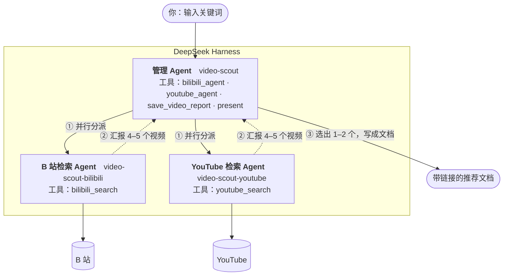
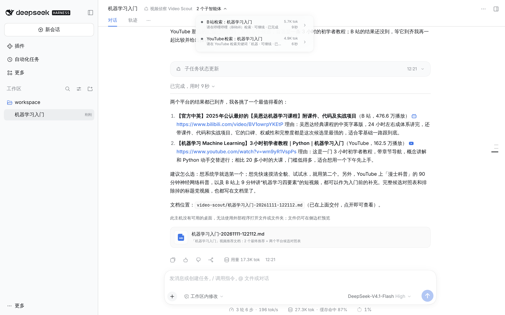
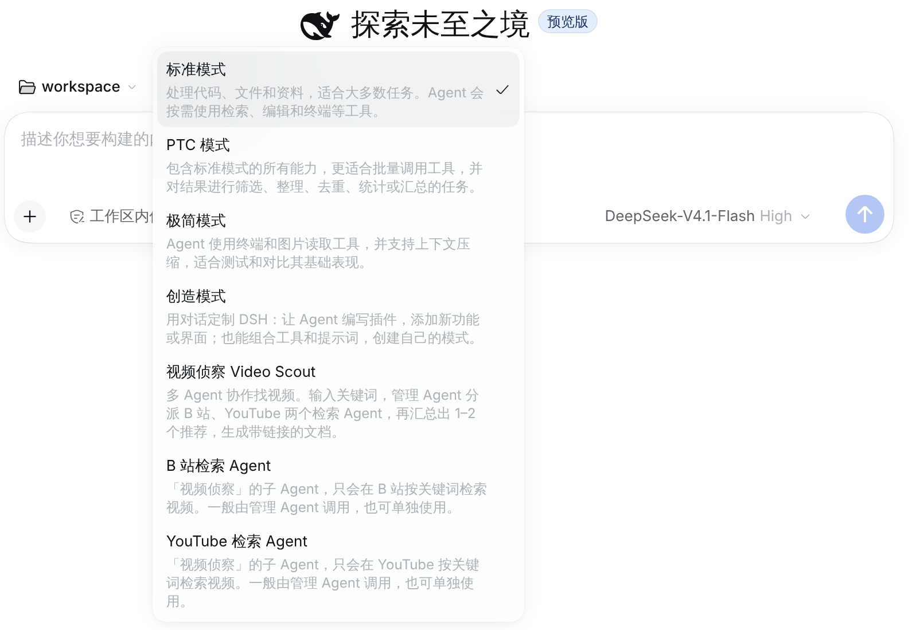
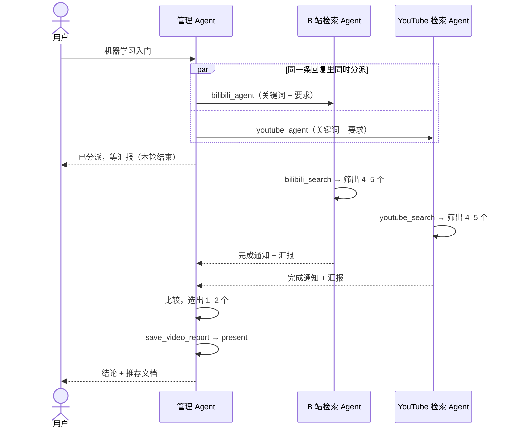

# 视频侦察 Video Scout

一个 [DeepSeek Harness](https://github.com/deepseek-ai/deepseek-harness)（DSH）插件，演示**管理 Agent + 多个分工不同的子 Agent** 怎么协作：

你给一个关键词，**管理 Agent** 把检索任务同时分派给 **B 站检索 Agent** 和 **YouTube 检索 Agent**；两个子 Agent 各自检索、各汇报 4–5 个视频；管理 Agent 综合比较，选出最值得看的 1–2 个，生成一份带链接的 Markdown 推荐文档交给你。



实际运行的样子（DeepSeek-V4.1-Flash，真实的 B 站和 YouTube 数据）——标题栏里能看到管理 Agent 派出的 2 个子智能体，下方是它的结论和交付的文档：



## 安装

需要先有 DSH（要求 Node ≥ 24.9）和一个能用的模型：在 DSH 的设置里登录 DeepSeek 账号或填 API Key，或者启动前导出 `DEEPSEEK_API_KEY`。

```bash
npm i -g @deepseek-ai/dsh
```

装插件只要一行：

```bash
dsh plugin --profile web add github:Tingfu-Zhou/Agent-Management-Multi-Agent-Collaboration
```

然后启动：

```bash
dsh web
```

插件是纯 JavaScript、零依赖，安装时不需要构建，也不需要给任何脚本授权。卸载：`dsh plugin --profile web remove dsh-video-scout`。

> 用桌面版 DSH 的话，把 `--profile web` 换成 `--profile desktop`。桌面版没有实测，下面的验证都是在 `web` 上做的。

## 使用

1. 新建会话，选一个工作区文件夹（推荐文档会保存在里面）。
2. 在输入框上方的模式菜单里选 **视频侦察 Video Scout**。
3. 输入关键词，比如 `机器学习入门`，发送。



接下来你会看到管理 Agent 派出 2 个子智能体，两份汇报回来之后给出结论，并在对话里附上文档。整个过程一分钟左右。菜单里的 **B 站检索 Agent** 和 **YouTube 检索 Agent** 就是那两个子 Agent，也可以单独拿来用。

文档保存在 `<工作区>/video-scout/<关键词>-<时间>.md`。下面是一次真实运行生成的文档的开头（[完整文档](docs/sample-report.md)）：

```markdown
# 「机器学习入门」视频推荐

> 两个检索 Agent 的工作：哔哩哔哩检索到 10 个、汇报 5 个；YouTube 检索到 10 个、汇报 5 个。管理 Agent 从中精选出 2 个。

## 综合结论
（管理 Agent 写的：两个平台的结果各有什么特点、为什么选这两个）

## 推荐视频
### 1. [【官方中英】2025年公认最好的【吴恩达机器学习课程】…](https://www.bilibili.com/video/BV1owrpYKEtP)
- **平台**：哔哩哔哩
- **作者**：吴恩达AI_AndrewNg
- **数据**：播放 476.6万 · 时长 23:04:56 · 发布 2025-01-04
- **推荐理由**：…
- **链接**：<https://www.bilibili.com/video/BV1owrpYKEtP>

## 候选对照
（两个检索 Agent 各自汇报的 5 个视频，⭐ 为最终推荐）
```

### 可选配置

都不配也能用。需要的话，在启动 DSH 前导出环境变量：

| 环境变量 | 作用 |
| --- | --- |
| `HTTPS_PROXY` | 访问 YouTube 需要代理时设置。DSH 会让所有请求走它 |
| `BILIBILI_COOKIE` | 浏览器登录 B 站后复制的 Cookie。匿名检索被风控（报 412）时再配 |
| `YOUTUBE_API_KEY` | YouTube Data API v3 的 Key。配了就走官方接口，不配走免 Key 检索 |

## 它是怎么工作的

整个插件分三层，每层都很薄。

**第一层：三个 Agent 是谁、谁管谁 —— 全在 [`cordis.patch.yml`](cordis.patch.yml) 里声明。**
DSH 里一个「预设」就是一个 Agent 的配方：人设 + 它能用的工具。这个文件声明了三个预设：

| 预设 | 人设 | 能用的工具 |
| --- | --- | --- |
| `video-scout` | 管理 Agent：分派、等汇报、做决策、出文档 | `bilibili_agent`、`youtube_agent`（委派）、`save_video_report`、`present` |
| `video-scout-bilibili` | 只负责 B 站的检索员 | `bilibili_search` |
| `video-scout-youtube` | 只负责 YouTube 的检索员 | `youtube_search` |

「管理」关系靠 DSH 自带的委派工具实现：管理 Agent 的预设里挂了两个 `@deepseek-ai/dsh-tool-subagent`，一个绑定 B 站预设，一个绑定 YouTube 预设。管理 Agent 调用 `bilibili_agent` 时，DSH 按绑定的预设新建一个子 Agent——独立的上下文、独立的人设、只有自己那一个检索工具。子 Agent 干完，DSH 把它的最终答复作为通知送回管理 Agent。

工具是隔离的：管理 Agent 没有检索工具，想自己搜也搜不了；检索 Agent 没有委派和写文档的工具，只能检索和汇报。

**第二层：三个工具 —— [`lib/`](lib) 里的三个插件入口。**

- `bilibili_search`（[`lib/sources/bilibili.js`](lib/sources/bilibili.js)）：不需要登录。先取匿名设备标识，再取 WBI 签名密钥，带签名调搜索接口。
- `youtube_search`（[`lib/sources/youtube.js`](lib/sources/youtube.js)）：默认走网页端自己用的 InnerTube 接口，不需要 Key；失败时退回解析搜索结果页；配了 Key 则走官方 Data API。
- `save_video_report`（[`lib/report.js`](lib/report.js)）：把管理 Agent 的决定写成 Markdown。

**第三层：DSH 自带的能力。** 子 Agent 的创建与调度、完成通知、`present`（把文件作为交付物展示给用户），都直接用 DSH 的，没有重新造。

一次完整的运行：



### 几个设计取舍

**模型做决定，事实由代码兜底。** 子 Agent 用自然语言汇报，管理 Agent 再转述进文档——这一来一回里，模型可能把链接抄错，甚至编一个。所以检索工具每次返回结果时都在进程里登记一份（[`lib/run-store.js`](lib/run-store.js)），`save_video_report` 只接受登记过的链接，标题、作者、播放量也一律用登记的数据。管理 Agent 只需要说「选哪个、为什么」。传一个没检索到过的链接，工具会拒绝并列出可选项；「最多 2 个」这条要求也是工具里强制的，不只是写在人设里。

**文档如实记录每个 Agent 做了什么。** 子 Agent 结束时，DSH 会发出一个带着它最终答复的事件；插件据此记下它汇报了哪几个视频。于是文档开头能写出「检索到 10 个、汇报 5 个、精选出 2 个」，候选对照表列的也正是子 Agent 汇报的那几个，而不是检索接口返回的全部。

**并行分派，异步等待。** 两个子 Agent 同时出发。管理 Agent 分派后就结束这一轮，不轮询；哪个子 Agent 先完成，它的汇报就先把管理 Agent 唤醒，两份到齐再做决定。

**一个平台失败不拖垮整体。** 检索失败时工具会给出原因和排障建议，子 Agent 如实上报，管理 Agent 基于另一个平台完成推荐，并在文档的备注里说明。

**用宿主的多 Agent 机制，而不是自己写调度。** 子 Agent 的生命周期、并发上限、取消、在界面上的展示，DSH 都已经做好了。插件只负责声明「有哪些 Agent、各自能干什么」。

## 验证过什么

| 验证 | 怎么跑 | 覆盖 |
| --- | --- | --- |
| 单元测试 | `npm test` | 39 个用例，离线。WBI 签名（对官方样例）、两个平台的结果解析、各种失败路径、文档渲染、链接核对 |
| 端到端测试 | `npm run e2e` | 在**真实的 DSH 0.2.2-rc.1** 里：全新安装 → 启动 → 用浏览器选预设、发关键词 → 检查派出了 2 个子 Agent、三个 Agent 工具各不相同、文档里的链接来自检索记录、文档作为交付物出现在对话里 |
| 真实站点 | `E2E_REAL_SITES=1 npm run e2e`<br/>`node bin/video-scout.mjs both 机器学习` | 检索工具访问真实的 B 站和 YouTube |
| 真实模型 | `E2E_REAL_MODEL=1 E2E_REAL_SITES=1 DEEPSEEK_API_KEY=… npm run e2e` | 用 DeepSeek-V4.1-Flash 完整跑了 5 次（3 次「机器学习入门」，另两次是「how transformers work」和「尤克里里入门教学」），都成功 |

默认的端到端测试里，模型是一个照着人设演的脚本（[`test/e2e/fake-llm.mjs`](test/e2e/fake-llm.mjs)），所以不需要 API Key、结果可复现。它证明的是插件和 DSH 的对接没问题，不代表真实模型的表现。

真实模型的 5 次运行里，从会话日志看行为一致：管理 Agent 在同一步里同时调用两个委派工具；每个检索 Agent 检索 1–2 次，再挑出 5 个汇报（汇报数量从第 2 次运行起才有记录）；管理 Agent 等两份汇报到齐后推荐 2 个，调用 `save_video_report` 和 `present` 各一次，没有工具报错。界面显示的用量：管理 Agent 的会话每次约 2.7–2.8 万 token，两个子 Agent 各 5 千左右。5 次不算多，换别的模型或关键词时表现可能不同。

本地目录、`npm pack` 的压缩包、`github:` 三种安装方式都用端到端测试跑通过。

跑端到端测试需要 `dsh` 命令和 [Playwright](https://playwright.dev/)（`npm i -g playwright && npx playwright install chromium`）；用 `DSH_BIN` 可以指定 `dsh` 的路径。

## 目录

```
cordis.patch.yml        三个 Agent 预设（人设、工具、委派关系）
lib/
  bilibili.js           插件入口：注册 bilibili_search
  youtube.js            插件入口：注册 youtube_search
  report.js             插件入口：注册 save_video_report
  search-tool.js        两个检索工具共用的工具定义
  run-store.js          检索结果登记簿
  report-render.js      链接核对、Markdown 渲染
  sources/              B 站 / YouTube 的检索实现（不依赖 DSH，可单独使用）
bin/video-scout.mjs     命令行：不经过 DSH 直接试检索
test/                   单元测试、夹具、端到端测试
```

## 已知限制

- **B 站风控。** 匿名检索偶尔会被拦（HTTP 412），云服务器的 IP 更容易遇到。稍等再试，或配置 `BILIBILI_COOKIE`。
- **YouTube 需要能访问。** 国内网络要配 `HTTPS_PROXY`。
- **YouTube 不能按发布时间排序。** 网页端已经不支持，所以 `youtube_search` 只提供「综合」和「播放量」两种排序。
- **检索记录只在内存里。** 任务跑到一半重启 DSH，管理 Agent 再保存文档时对不上记录；工具会放行格式合法的链接，但在文档里标注「未核对」。
- **检索 Agent 还能看到一个 `working_directory` 工具。** 它是 DSH 全局注册的，不属于这个插件；实测中模型没有去用它。
- **只在 DSH 0.2.2-rc.1 的 `web` profile 上测过。** DSH 还在预览阶段，接口可能变；`package.json` 里的 `engines.dsh` 据此限定了版本范围。
- 检索用的是两个站点的网页端接口，不是官方开放 API（YouTube 配了 Key 时除外），站点改版可能导致失效。请只用于个人学习和演示。

## 致谢

实现时参考了 [dsh-bili-whale](https://github.com/Alterssss/dsh-bili-whale) 和 [OpenBiliClaw](https://github.com/whiteguo233/OpenBiliClaw)。WBI 签名算法来自 [bilibili-API-collect](https://github.com/SocialSisterYi/bilibili-API-collect) 的文档。

[MIT](LICENSE)
